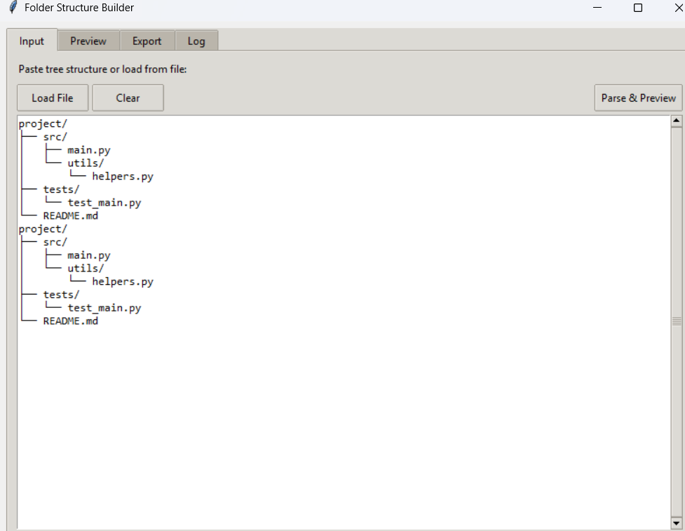
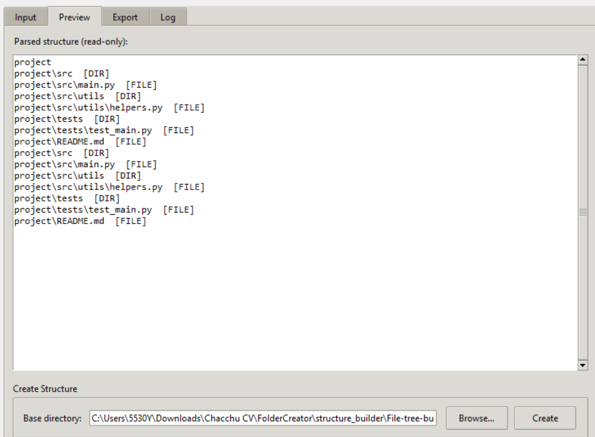

# Folder Structure Builder

A cross-platform GUI tool that converts tree-style text into actual folder and file structures on disk, and vice versa.

## Features

- Parse tree-style text into a structured representation
- Preview parsed items before creating anything on disk
- Create folders and empty files from the parsed structure
- Export any existing directory back into tree-style text
- Load structure definitions from `.txt` files
- Full operation log with status tags

## Screenshot

| Input | Preview |
|:---:|:---:|
|  |  |

## Installation

No external dependencies. Uses only the Python standard library.

```bash
# Requires Python 3.10+
python structure_builder.py   